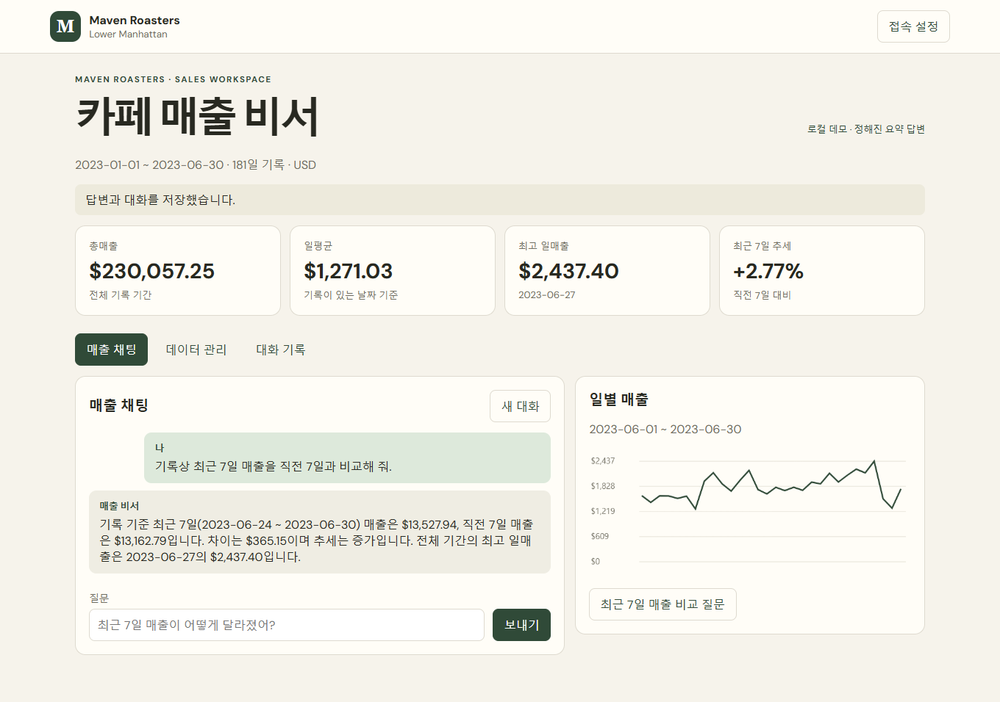
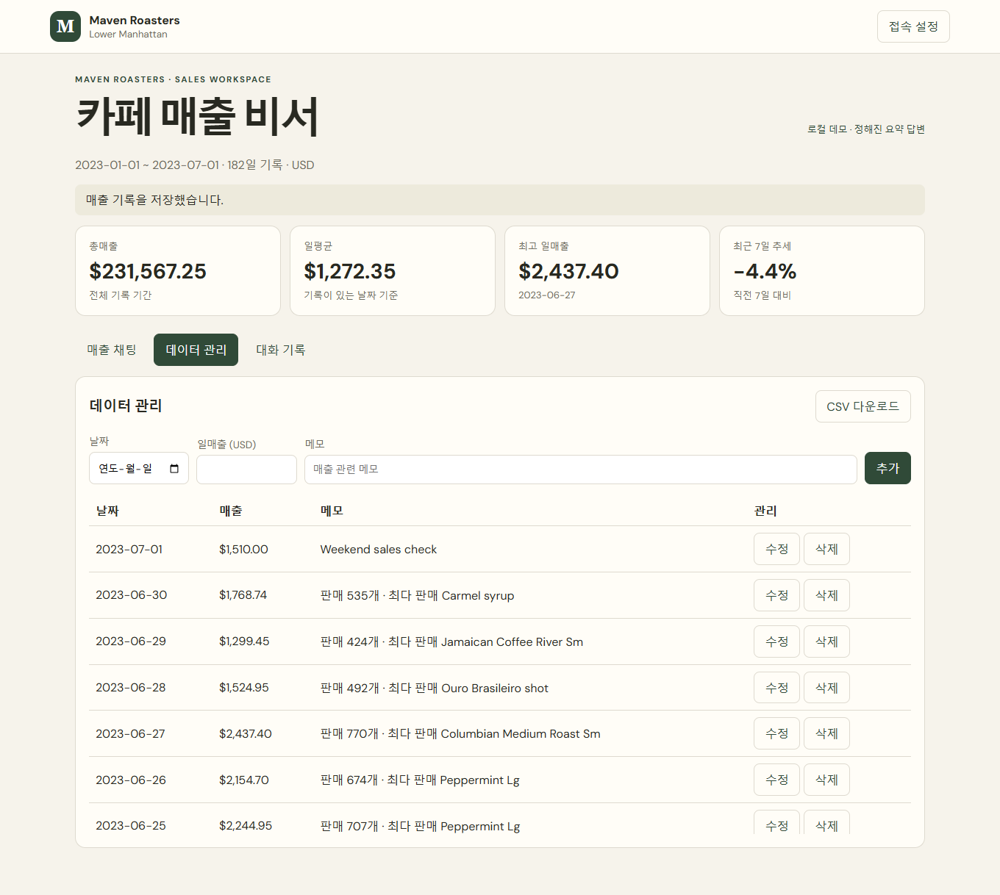
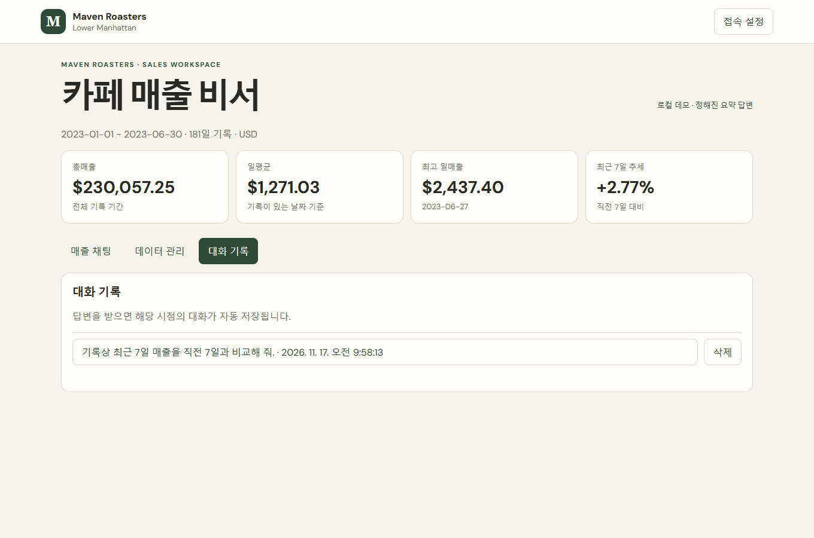
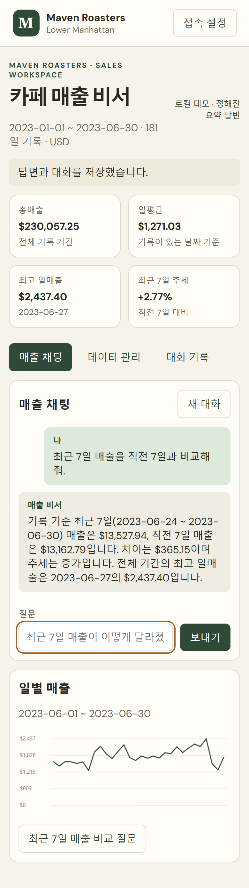
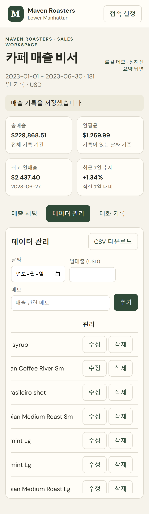

# Maven Roasters 매출 비서

카페 운영자가 매출 흐름을 확인하고 기록을 업데이트하며 자연어로 통계를 질문할 수 있는 웹 앱입니다. Maven Analytics의 가상 카페 거래 중 Lower Manhattan 지점의 2023년 1월 1일~6월 30일 데이터를 일별 USD 매출 181건으로 집계했습니다.

## 기술 스택

- Python 3.10+, FastAPI, Uvicorn, Pydantic
- Firebase Admin SDK와 Firestore, 로컬 미리보기에는 SQLite
- Anthropic Messages API, HTML/CSS/JavaScript
- Render 백엔드 및 Vercel 프론트엔드 배포 설정

## 로컬 실행 (PowerShell)

```powershell
python -m venv .venv
.venv\Scripts\python -m pip install -r requirements.txt
if (!(Test-Path .env)) { Copy-Item .env.example .env }
.venv\Scripts\python -m uvicorn main:app --reload
```

[서비스](http://127.0.0.1:8000/)와 [Swagger UI](http://127.0.0.1:8000/docs)를 열 수 있습니다. SQLite에서는 첫 실행 시 샘플을 넣습니다. Claude 연결 설정이 비어 있으면 데이터에서 산출한 고정 형식의 데모 답변을 사용합니다. SQLite 데모에서 실제 자연어 분석을 활성화하거나 Firestore 모드에서 채팅을 사용하려면 `ANTHROPIC_API_KEY`와 `ANTHROPIC_BASE_URL`을 설정하세요.

## 환경 변수

| 변수 | 용도 |
| --- | --- |
| `STORAGE` | 기본값 `sqlite`, 배포 시 `firestore` |
| `FIREBASE_SERVICE_ACCOUNT_JSON` | Firestore 서비스 계정 JSON 전체 (Firestore 모드 필수) |
| `ANTHROPIC_API_KEY` | Anthropic 네이티브 게이트웨이 키 |
| `ANTHROPIC_BASE_URL` | 발급처의 HTTPS 게이트웨이 기본 주소. 이 프로젝트는 `https://copa.codyssey.kr` 사용. 앱이 `/v1/messages`를 붙임 |
| `ANTHROPIC_MODEL` | 기본값 `claude-haiku-4` |
| `APP_TOKEN` | 공유 데모에 사용할 서버 생성 접속 토큰. Render 필수. 접속 설정 또는 Swagger Authorize에서 입력 |
| `CORS_ORIGINS` | 허용할 프론트엔드 출처를 쉼표로 구분 |
| `API_BASE_URL` | Vercel 빌드 변수. Render HTTPS 출처 (경로 제외) |

Firebase 콘솔에서 프로젝트와 Firestore 데이터베이스를 생성하세요. 서비스 계정 JSON을 로컬 `.env`에 넣을 때는 한 줄로 정리한 JSON을 작은따옴표로 감싸세요. Render에서는 JSON 전체를 환경 변수에 붙여 넣으세요. 키와 토큰은 백엔드에서 관리하며 Vercel 변수에는 공개 API 주소만 설정합니다.

Firestore 초기 데이터는 해당 설정을 적용한 로컬 터미널에서 다음 명령으로 등록합니다.

```powershell
.venv\Scripts\python -m app.seed
```

## 데이터와 API 흐름

[원본 데이터 및 라이선스](https://mavenanalytics.io/data-playground/coffee-shop-sales) · [집계에 사용한 공개 CSV 사본](https://github.com/RyadulSeam/coffee-shop-sales-analytics). 지점별 거래 중 Lower Manhattan만 남겨 `transaction_qty × unit_price`의 합을 일별로 계산했습니다. 메모에는 판매 수량과 수량 기준 최다 판매 품목을 기록했습니다. 같은 날짜의 매출 기록은 합산합니다. 추세는 마지막 기록일까지의 최근 7일과 직전 7일을 비교하고 14일에 모두 기록이 있을 때 표시합니다. 재집계 명령은 `python scripts/prepare_data.py 원본.csv`입니다.

- `main.py`는 앱, CORS, 정적 파일을 설정하고 `app/routes.py`는 API를 제공합니다. `app/models.py`에서 날짜, 매출 범위, 메시지 길이와 순서를 검증합니다.
- `/api/data`에서 매출을 추가·조회·수정·삭제합니다. `/api/data/summary`와 채팅 API는 `app/analysis.py`의 같은 계산을 사용합니다.
- `POST /api/chat`은 최신 매출 요약을 시스템 지침에 넣고 사용자 메시지 이력을 Claude에 전달합니다. 답변이 완료되면 대화 전체가 자동 저장됩니다.
- Firestore의 `data`, `conversations` 컬렉션에는 각각 매출과 대화가 저장됩니다. `GET /api/conversations`는 목록용 메타데이터를, `GET /api/conversations/{id}`는 전체 메시지를 반환합니다.

### 컨텍스트 주입의 장점과 한계

| 장점 | 한계 |
| --- | --- |
| 채팅 요청 시 최신 매출을 다시 집계해 기간, 통화, 최근 7일 매출과 직전 7일 매출을 모델에 전달합니다. 답변이 저장된 수치에 근거할 가능성이 높아지고, 매출 수정도 다음 질문에 반영됩니다. | 요약과 대화 이력은 매 요청마다 입력 토큰을 사용합니다. 이력이 길수록 비용과 지연이 늘고 모델의 컨텍스트 한도에 도달할 수 있습니다. 요약에 빠진 날짜별 세부 정보는 답변 근거가 부족할 수 있습니다. |
| 전체 일별 시계열을 보내는 대신 집계값을 전달해 입력 크기를 줄입니다. | 최고 매출일의 메모와 채팅 내용은 모델 제공자에게 전달됩니다. 현재 자동 마스킹은 없으므로 고객 개인정보, API 키, 내부 기밀은 메모와 질문에 입력하지 않습니다. |

프롬프트에서는 그래프용 일별 배열 `series`를 제외하고 최고 매출일 메모를 최대 5개로 제한합니다. 채팅 요청 이력은 최대 59개 메시지, 메시지당 4,000자입니다. 출력은 최대 1,000토큰으로 설정합니다. 입력 제한은 메시지 개수와 글자 수 기준이며 별도의 토큰 예산 계산은 적용하지 않습니다.

## Vercel 단일 프로젝트 배포

Vercel에서 저장소 루트(`./`)와 **FastAPI** 프리셋을 선택합니다. `main.py`가 화면과 API를 같은 출처에서 제공합니다. 이 구성에는 `API_BASE_URL` 설정이 필요 없습니다.

Vercel 프로젝트의 Production 환경 변수에 `STORAGE=firestore`, `FIREBASE_SERVICE_ACCOUNT_JSON`, `ANTHROPIC_API_KEY`, `ANTHROPIC_BASE_URL=https://copa.codyssey.kr`, `APP_TOKEN`을 설정합니다. Firebase JSON, Claude 키, 접속 토큰은 **Sensitive**로 저장합니다. 재배포 후 주소의 `/docs`에서 API를 확인하고 메인 화면의 **접속 설정**에 접속 토큰을 입력합니다.

과제의 Render 지정 배포에는 아래 절차를 사용합니다.

## 배포 (Vercel 먼저)

1. 프로젝트를 GitHub 저장소에 올립니다. `.env`와 서비스 계정 키는 로컬에 보관하고 예시 파일의 키 값이 비어 있는지 확인합니다.
2. Vercel에서 **Add New → Project**로 저장소를 가져옵니다. **Framework Preset**은 **Other**, **Root Directory**는 `frontend`를 선택합니다. 빌드 및 출력 경로는 `frontend/vercel.json`에 있습니다. 이 단계에서는 `API_BASE_URL` 없이 배포하면 화면에 백엔드 연결 대기 상태가 표시됩니다.
3. Render에서 같은 저장소를 Blueprint로 연결해 `render.yaml`의 서비스를 만듭니다. Firebase와 Anthropic 환경 변수를 입력하고 `CORS_ORIGINS`에 Vercel의 HTTPS 출처를 설정합니다. 생성된 `APP_TOKEN`을 확인합니다.
4. Vercel의 **Settings → Environment Variables**에서 `API_BASE_URL`에 Render의 HTTPS 출처를 입력하고 배포를 다시 실행합니다.
5. Vercel에서 접속 토큰으로 매출 조회와 채팅을 확인하고 Render의 `/docs`를 엽니다. 무료 Render 서버의 첫 요청은 지연될 수 있습니다.

## 현재 배포 주소

| 프론트엔드 URL | 백엔드 Health URL | Swagger URL |
| --- | --- | --- |
| [카페 매출 비서](https://cafe-sales-dashboard-drab.vercel.app/) | [FastAPI 상태 확인](https://cafe-sales-dashboard-drab.vercel.app/health) | [API 문서](https://cafe-sales-dashboard-drab.vercel.app/docs) |

현재 운영 주소는 Vercel 단일 프로젝트입니다. 배포 환경에서 Firestore 일매출 181건과 총매출 USD 230,057.25를 조회했습니다. 서비스의 **접속 설정** 또는 Swagger의 **Authorize**에 운영자가 제공한 접속 토큰을 입력하면 API를 사용할 수 있습니다. 공개 배포의 Claude 채팅은 `ANTHROPIC_API_KEY`를 Production에 등록하고 재배포하면 활성화됩니다. 실제 Claude 응답과 대화 자동 저장은 로컬에서 확인했습니다. Render 배포는 별도 과제 조건입니다.

## 제출 화면

아래 화면은 로컬 데모 데이터를 사용합니다.

| 채팅과 매출 요약 | 매출 저장 | 대화 기록 |
| --- | --- | --- |
|  |  |  [불러온 대화 화면](screenshots/history-loaded.png) |


### 모바일 사용성 검증

Chromium의 **390 × 844 CSS 픽셀 터치 뷰포트**에서 로컬 SQLite 샘플과 데모 답변으로 검증했습니다.

- **채팅과 차트**에서 Enter로 질문을 전송하면 입력창이 즉시 비워지고 비교 답변이 표시됩니다. 차트는 채팅 아래에 한 열로 배치되며 화면 너비에 맞춰 축소됩니다.
- **데이터 편집**에서 첫 행의 수정 버튼을 터치해 금액을 바꾸고 저장한 뒤, 저장 메시지와 목록의 새 금액을 확인했습니다. 넓은 표는 표 영역 안에서 가로 스크롤되고 페이지 전체에는 가로 넘침이 없었습니다.

| 모바일 질문·답변 및 차트 | 모바일 데이터 수정 후 저장 |
| --- | --- |
|  |  |
